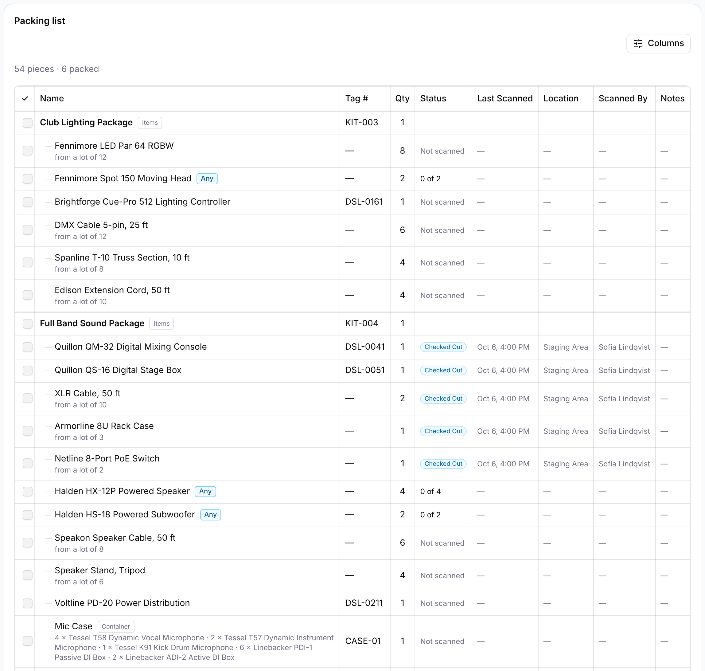
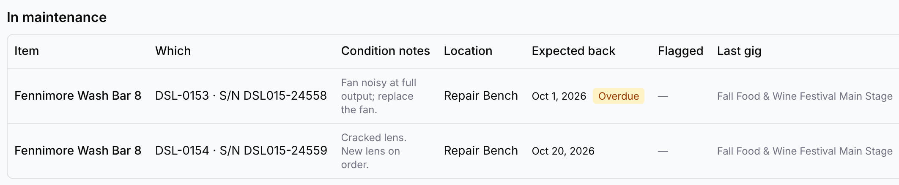

A gig's **packing list** shows what the gig needs and what's been packed for it. The
[**Maintenance**](#maintenance) list shows what's out of service for repair.

<!-- TODO: write the Manifest section. Still to cover:
- **Manifest**: **Equipment → Locations → Print manifest**. Dedupes assets across kit
  levels; interactive checkboxes on screen.
- When a field tech reaches for it.
Screenshots: Manifest with checkboxes.
Source: Plan §4, Prompt 7. Commits `Inventory reports` (2026-05-31) + 2026-08-26 fixes. -->

## Packing list

The packing list shows every piece of your organization's equipment a gig needs, kit
by kit, and how much of it is packed. To open it, open the gig and select the
**Equipment** tab. The **Packing list** card is at the bottom, below the gig's
equipment table, **Equipment needed** and **Not returned**.

Above the list, a line counts the pieces and how many are packed, such as
"54 pieces · 6 packed". A piece is one thing you pick up: a unit, one cable from a
lot, or a whole container. A packed piece is one that's been scanned out to this gig
and hasn't come back. Pieces that are checked back in at the warehouse don't count as
packed.

If the gig has no kits yet, you'll see "No kits assigned to this gig."

### How the list is laid out

Each kit assigned to the gig is a heading in bold, A to Z, with an **Items** or
**Container** badge. What's in the kit is listed under it, indented. Nested kits don't
get headings of their own. For example, the gear in "FOH Console Package" and
"Main PA: 4 Top / 2 Sub" is listed straight under "Full Band Sound Package". If the
same item or lot appears in two nested kits, it's one line with the quantities added
up.

Gear added from a phone while packing is marked too. A kit added that way has an
**Added at pack-out** badge. Units and lots added on their own are listed last, under
**Added at pack-out**. See [Adding equipment at pack-out](/mobile/adding-at-pack-out/).

The columns are:

- **✓**: a box to check off on screen. See [Checking items off](#checking-items-off).
- **Name**: the kit, item or container.
- **Tag #**: the tag of a unit, a container or a kit, or "—".
- **Qty**: how many the kit asks for.
- **Status**, **Last Scanned**, **Location**, **Scanned By** and **Notes**: the line's
  newest scan at this gig. A line that hasn't been scanned shows "Not scanned" under
  **Status**.

Select **Columns** to hide or show the last five columns. This browser remembers your
choice for every packing list, and the printout uses the same columns.

A kit that's also on another gig at overlapping times shows a **Conflict** badge. See
[Conflict detection](/gigs/conflict-detection/).

### Specific units and lots

A specific unit is one line with its tag, such as "Quillon QM-32 Digital Mixing
Console" with tag `DSL-0041`. Its **Qty** is 1.

A lot is a counted group of pieces with no tag. Its line shows how many the kit needs
under **Qty**, and the size of the lot you're taking them from underneath, such as
"XLR Cable, 50 ft", **Qty** 2, "from a lot of 10". While a lot is partly packed,
**Status** shows how many are packed so far, such as "4 of 6".

### "Any" lines

An "any" line asks for a number of whatever units of an item you own. It shows the
item's name with an **Any** badge, and the number under **Qty**. For example, the
Main PA asks for 4 × any "Halden HX-12P Powered Speaker".

Its **Status** shows how many are packed so far: for an item whose units have tags,
how many are scanned, such as "1 of 4", with the tags of those units under the name.
For an item with no tags, it shows how many were counted and how many are still
missing, such as "7 counted · 3 short", and then "10 counted" once they're all there.

A unit that's on its own line elsewhere in the same kit doesn't fill an "any" line.

### Containers

A container, such as the "Mic Case" or the "XLR Cable Box", is one line, because it
travels as one sealed case. It has a **Container** badge and its tag, and you scan the
case, not what's in it. Underneath, indented, it lists what the case holds, such as
"16 × XLR Cable, 25 ft · 4 × XLR Cable, 50 ft". A long list wraps onto more lines.

A container inside a kit is indented under that kit. A container assigned to the gig on
its own is a heading of its own.

### Checking items off

When you pack, you can check lines off on screen as you go.

1. On the gig's **Equipment** tab, find the line in **Packing list**.
2. Select the box in the **✓** column.

The line's name is crossed out. Select the box again to undo it.

:::note
Checks are a scratchpad for one packing pass. They aren't saved, and they clear when you
reload the page or the list refreshes. To record that something is packed, scan it.
:::

### Printing the packing list

1. Open the gig.
2. Select **Print → Packing list**.

**Print** is at the top of the gig page. It's hidden while you're editing the gig; select
**Done** first.

The printout starts with "Packing list" and your organization's name, then the gig's
title and date. On the right, it shows how many kits and pieces there are, such as
"2 kits · 54 pieces", and the date it was printed. Below that is the list, with the
columns you chose under **Columns**.

To fill in by hand:

- **A tagged "any" line** gets a blank to write in for each piece, up to 24. Write the
  tag of each unit you pack.
- **A counted "any" line** gets a box and a blank: "☐ count ______". Write the number
  you counted.
- **Every line** has an empty box in the **✓** column to tick.

## Maintenance

**Equipment → Maintenance** lists the equipment that's out of service for repair: what
it is, what's wrong with it, where it is and when it's due back. Everyone in the
organization can see the list. Admins, Managers and Staff can update it; Viewers see
it without buttons.

### Sending equipment to maintenance

- **On a computer:** open the unit or lot, choose **Edit**, set **Status** to
  **Maintenance** and save. Then add its details from the list.
- **On a phone, while scanning:** turn on **Send to Maintenance** in a line's note. See
  [Notes and Maintenance](/mobile/field-inventory/#notes-and-maintenance).

Either way, the whole unit or lot goes in at once.

Equipment in maintenance isn't counted as available in a kit's **Availability**, and a
gig's [Equipment needed](/gigs/conflict-detection/#equipment-needed) table counts it
under **In maintenance**, not **Free**. Pack-Out on the phone asks before packing it.

### Reading the list

The line above the list counts the pieces, such as "2 in maintenance". **Print** prints
the list.

Each row shows:

- **Item** and **Which:** a unit's tag and serial, such as "DSL-0153 · S/N DSL015-24558",
  or for a lot "Whole lot of 6". Pieces split off a lot read "2 split from the lot (now 8)".
- **Condition notes:** what's wrong with it.
- **Location:** where it is while it's being fixed, such as "Repair Bench". This is the
  list's own field; [Locations](/equipment/location-explorer/) shows where its last scan
  put it.
- **Expected back:** the date it should be ready, marked **Overdue** once it's passed.
- **Flagged:** when it was sent to maintenance, and by whom.
- **Last gig:** the gig it was last used on.

**Flagged, not home yet** appears below when equipment has been marked to go into
maintenance when it comes back from a gig. It shows the gig in **Coming home from**.
Until it's back, it stays available and at the gig; when it's unloaded, it moves to
**In maintenance**.

### Updating an entry

- **Edit** opens **Maintenance details**: **Condition notes**, **Location** and
  **Expected back**. Select **Save**.
- **Return to service** puts it back in use. GigWrangler asks first, and says what will
  happen:
  - a unit or whole lot "goes back to the status it had before", Active or Inactive;
  - pieces split off a lot go back into their lot, "goes back into its lot (now 8)";
  - if the lot can't take them back, for example because it's been disposed of, they
    come back as a lot of their own.
- **Cancel flag**, on **Flagged, not home yet**, means it won't go into maintenance when
  it comes home.

To get rid of something that isn't worth fixing, an Admin or Manager sets its **Status**
to **Disposed** on the equipment's own page.

## Related

- [Assigning equipment to a gig](/equipment/assigning-to-a-gig/)
