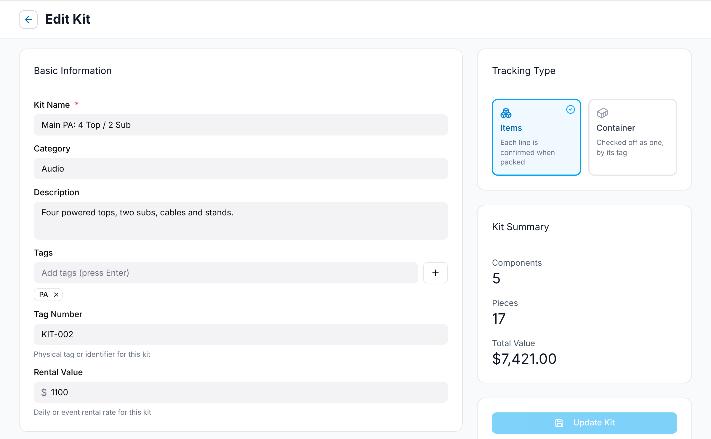
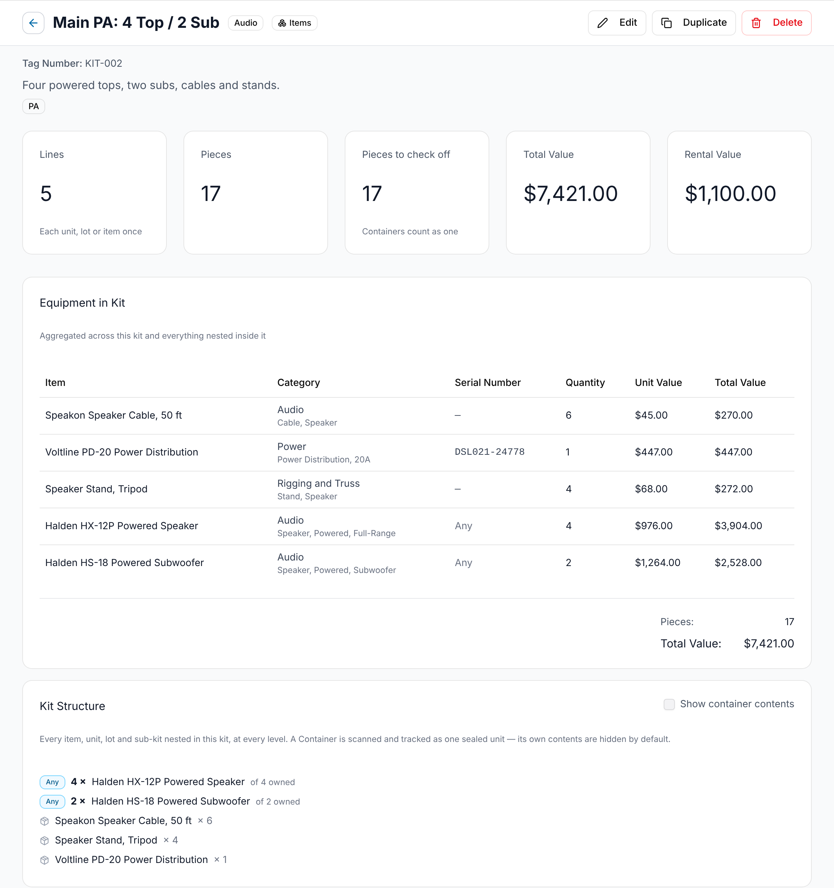

<!-- Source: src/components/KitScreen.tsx (editor), src/components/KitDetailScreen.tsx (kit page), src/components/KitListScreen.tsx, src/services/kit.service.ts, src/utils/equipmentItems.ts. Plan §4, Prompt 7. docs/development/hierarchical-kits-manual-test-checklist.md. -->

A kit is a named package of gear that goes out together, such as "Main PA: 4 Top / 2 Sub". You assign kits to gigs instead of listing every cable. Find them under **Equipment → Kits**. Everyone can open a kit. Admins and Managers create and change kits, and only Admins delete them.

The list shows each kit's **Category**, **Tag #**, **Items** (its pieces), **Total Value**, **Rental Value** and **Tags**, and where it is: **Tracking Status**, **Last Location** and **Active Gig**. Admins and Managers can change a kit's category, tag number, rental value, tags and description right in the list.

## What goes in a kit

Each line of a kit is one of three things:

- **Any of an item**: a number of whatever units of an item you own, such as 4 × any Halden HX-12P Powered Speaker. The kit doesn't care which four.
- **A specific unit or lot**: one tagged unit, such as a particular console, or a counted lot with no tag, such as your 25 ft XLR cables.
- **Another kit**: a whole kit nested inside this one. See [Nesting kits](#nesting-kits).

An *item* is what a thing is (the model). A *unit* is one physical piece you own, with a tag or serial number. A *lot* is a counted group of identical pieces with no tag.

## Creating a kit

1. Open **Equipment → Kits** and select **Create Kit**.
2. Enter **Kit Name**. It's the only required field under **Basic Information**.
3. Fill in the other fields under **Basic Information** if you want them:
   - **Category**, such as `Audio`. It suggests the categories your other kits use.
   - **Description**: what the kit is for.
   - **Tags**: type a tag and press Enter, or select the plus button next to the field.
   - **Tag Number**: the physical tag on the kit, such as `KIT-002`.
   - **Rental Value**: what you charge for the kit per day or event.
4. Under **Tracking Type**, choose **Items** or **Container**. See [Containers](#containers).
5. Under **Kit Contents**, select **Add Components** and add at least one line. See [Adding lines](#adding-lines).
6. Select **Create Kit**.

If **Kit Name** is empty or the kit has no lines, you'll see "Please fix the errors before submitting", and the field shows what's missing.

## Adding lines

Select **Add Components**. The dialog lists everything you can add, in three groups: **Any of an item**, **A specific unit** and **Kits**.

1. Search by name in **Search items, units and kits...**, or narrow the list with **Items**, **Units** or **Kits** (**All** is the default).
2. Select each row you want. A check appears.
3. For an item or a unit, enter how many in **Qty**.
4. Select **Add 2 Selected** (the button counts your picks). The lines appear in **Kit Contents**.

Things already in the kit are hidden. Turn on **Show items already in this kit** to see them grayed out, with the reason, such as "Already in this kit". A kit that would make a loop is always shown grayed out (see [Nesting kits](#nesting-kits)). Units that are no longer owned (disposed, returned, missing or given a retirement date) never appear.

### "Any" lines

Use an "any" line when any unit of a model will do. Most kits are built this way: the Main PA asks for 4 × any Halden HX-12P Powered Speaker and 2 × any Halden HS-18 Powered Subwoofer, not four particular speakers.

1. In **Add Components**, find the item under **Any of an item**. Each row shows how many you own and how many are available, such as "4 owned · 4 available".
2. Select it and enter the number you need in **Qty**.
3. Select **Add 1 Selected**.

In **Kit Contents**, the line shows the item name with "any unit" under it, and the **Kind** is **Any**. The **Availability** column shows the count again, such as "4 units owned · 4 available". For an item kept in lots, it counts pieces instead, such as "12 pieces owned · 10 available". You can change **Quantity** at any time.

*Available* means in working order and not packed in a container kit. Units in maintenance, inactive units and pieces inside a container kit don't count. It doesn't look at other gigs. To check a gig's dates for clashes, see [Assigning equipment to a gig](/equipment/assigning-to-a-gig/).

### Asking for more than you have

GigWrangler doesn't stop you asking for more than are available. It warns you instead. When the quantity is more than the available count, the **Availability** text turns amber and says why, for example:

- 4 × any Fennimore Wash Bar 8: "4 units owned · 2 available", "2 in maintenance".
- Units that are inactive: "… inactive".
- An item packed in a container kit: "… in container kits".

You can still save the kit. Lower the quantity, or fix the gear, before the gig.

### Specific units and lots

A specific line names one unit or one lot. Its **Kind** is **Unit** or **Lot**, and **Availability** says **Specific unit** or **Specific lot**.

- A unit line is always 1. A lot line can be up to the lot's count; the picker shows it as "… in stock". In the kit, it reads "Specific lot · 6 pieces".
- If a kit asks a lot for more pieces than it holds, for example after a write-off, an amber note says so, such as "asks for 6, lot has 4". The gig's **Equipment needed** table shows the same note.
- A unit in maintenance or inactive shows in amber, such as "In maintenance: not available now" or "Inactive: not available now".
- A unit that's no longer owned shows in red, with its status: "Retired: no longer owned. Remove it from the kit.", or **Disposed**, **Returned** or **Missing** in place of **Retired**. A unit is **Missing** after it's [written off at a gig](/equipment/assigning-to-a-gig/#writing-off-missing-equipment).
- The same unit or lot can't be in a kit twice, even through a nested kit. The picker says "Already in this kit via FOH Console Package", for example.

### Which to use

- Use **any** for interchangeable gear: speakers, wedges, moving heads. If one unit goes in for repair, the kit still works with another.
- Use a **specific unit** when it must be that one: the console with your show file, a rack built around one stage box.
- Use a **lot** for counted gear without tags: cables, stands, DI boxes.

An "any" line and a specific unit of the same item add up. "4 × any Halden HX-12P" plus one specific HX-12P means the kit takes five speakers.

## Nesting kits

A kit can hold other kits. "Full Band Sound Package" holds "FOH Console Package", "Main PA: 4 Top / 2 Sub", the "Mic Case" and the "XLR Cable Box", plus 4 × any Halden HX-8M Floor Monitor of its own.

To nest a kit, add it from the **Kits** group in **Add Components**. A nested kit is always one line with a quantity of 1. The same kit can sit inside several parent kits, and kits can nest more than one level deep.

GigWrangler stops two kinds of mistake:

- **Loops.** You can't put a kit inside one of its own nested kits. The picker shows "Would create a circular reference — this kit is already nested inside …".
- **Doubles.** You can't add a kit that holds a unit or lot already in this kit. It shows "Contains assets already in this kit".

When you open a kit nested more than six levels deep, you'll see "This kit is nested … levels deep — is that intentional?".

## Containers

A container is a kit for a case, box or tote that travels as one piece, such as the "Mic Case". Set it with **Tracking Type**:

- **Items**: "Each line is confirmed when packed". The usual choice.
- **Container**: "Checked off as one, by its tag". Give it a **Tag Number** that matches the label on the case.

On a parent kit's page, **Pieces to check off** counts a container as one piece. The gear inside it is committed to the case, so other kits' "any" lines don't count it as available.

On a gig's [packing list](/equipment/inventory-reports/), a container is one line, with its tag and what it holds listed under it. A nested **Items** kit isn't a line of its own: its gear is listed under the top kit. When [scanning on a phone](/mobile/field-inventory/), scanning a container's tag checks off the case and everything in it. Nested **Items** kits show indented under their parent, and are done when all their pieces are.

## The kit editor's summary

While you edit, **Kit Summary** on the right shows:

- **Components**: the number of lines.
- **Pieces**: every piece the lines add up to. A nested kit counts everything in it.
- **Total Value**: the replacement value of the contents. An "any" line is valued at the item's average piece.

Each line in **Kit Contents** also shows **Unit Value** and **Total Value**. To remove a line, select the red X at the end of its row. Nothing is saved until you select **Create Kit** or **Update Kit**.

## The kit page

Open a kit from the list to see its page. The header shows the name, its category and **Items** or **Container**, with the tag number, description and tags under it. Admins and Managers see **Edit** and **Duplicate**. Admins also see **Delete**.

The cards across the top count everything in the kit, through every nested kit:

- **Lines**: each unit, lot or item once.
- **Pieces**: every piece. A lot counts its pieces.
- **Pieces to check off**: what you'd pick up, with "Containers count as one".
- **Total Value** of the contents, and the kit's own **Rental Value**.

### Equipment in Kit

**Equipment in Kit** lists every unit, lot and item in the kit and everything nested in it, with **Quantity**, **Unit Value** and **Total Value**. If two nested kits ask for the same thing, it's one row with the total. A specific unit shows its serial number in **Serial Number**, and an "any" line shows **Any**.

### Kit Structure

**Kit Structure** shows the kit as a tree: each line, and each nested kit with its own lines indented under it. An "any" line reads like "4 × Halden HX-12P Powered Speaker of 4 owned"; other lines read like "Speaker Stand, Tripod × 4". Each nested kit is marked **Items** or **Container**.

A container's contents are hidden at first. Turn on **Show container contents** to see what's in each case.

**Change History** at the bottom lists who changed the kit and when.

## Editing, duplicating and deleting

- **Edit** opens the kit editor. Change what you need and select **Update Kit**. It's grayed out until you change something.
- **Duplicate** saves a copy named "… (Copy)" with the same lines and opens it in the kit editor. The **Tag Number** is left blank; if the original had one, you'll see "Kit duplicated. Give the copy its own Tag Number." Enter one and select **Update Kit**.
- **Delete** asks "Are you sure you want to delete "…"?". Admins only. Deleting a kit also takes it out of every kit it's nested in.

From the kit list, the row menu has **View**, **Edit Configuration**, **Duplicate** and **Delete**. Duplicate there adds the copy to the list without opening it. Staff and Viewers see only **View**, and Managers see **Delete** grayed out.

## Related

- [Assigning equipment to a gig](/equipment/assigning-to-a-gig/)
