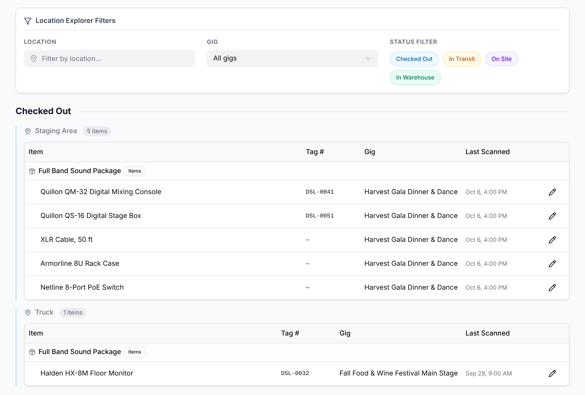

**Equipment → Locations** shows where your equipment is right now: what's checked out,
on a truck, at a venue or back in the warehouse. Every scan on the phone, and every
correction, updates it. Everyone in the organization can see it; Admins and Managers
can also correct a record.

## Reading the page

The page is grouped by status, such as **Checked Out** or **In Warehouse**, and then by
place, such as "Staging Area" or "Warehouse, Bay 2", with how many items are there.
Inside each place, equipment is listed under its kit, which has an **Items** badge.
Each line shows the **Item**, its **Tag #**, the **Gig** of its latest record and when
it was **Last Scanned**.

Each piece of equipment shows where its newest record puts it, across all gigs. A
monitor that went out to one gig and then on to another shows once, at the second gig.

### Cases

A case, such as the "Mic Case", has a **Container** badge. Open it to see what's
inside. When you scan a case, its contents are recorded with it, so they normally show
under the case.

If the case and its contents end up in different places, for example after you
correct the case's location by hand, the contents are listed in full under the case's
name with a **Contents** badge, at the place their own records give.

### Items without tags

Items without tags, such as cables, stands and the mics in a case, are counted rather
than tagged.

- **Inside a case,** they're one place: wherever their newest record in that case puts
  them.
- **Loose,** they show at each gig where pieces are still out, and once at home for
  the pieces that came back. A box of cables split between two gigs shows at both.

## Filtering

Use the filters at the top to narrow the list:

- **Location:** one place, such as "Truck".
- **Gig:** equipment whose current record is from that gig. Equipment that has since
  moved on to another gig isn't listed.
- **Status Filter:** select a status to hide or show it. All four are on to start with.

The filters look at where things are now, not at older records. If nothing matches,
you'll see "No items found matching the selected filters."

## Correcting a record

Admins and Managers can fix a record that's wrong, such as a case that came back
without being scanned.

1. Select the pencil button at the end of the item's line, or of the case's line.
2. In **Manual Tracking Override**, choose the **Gig**, the **Status** and the
   **Location**, and add **Notes** if you like.
3. For a single item, you can also tick **Mark for Maintenance**.
4. Select **Save Override**.

The correction is a new record, so the item moves to its new place right away, and
the history of earlier records stays. Correcting a case moves the case. What's in it
keeps its own records.

## Related

- [Scanning equipment on your phone](/mobile/field-inventory/)
- [Assigning equipment to a gig](/equipment/assigning-to-a-gig/)
