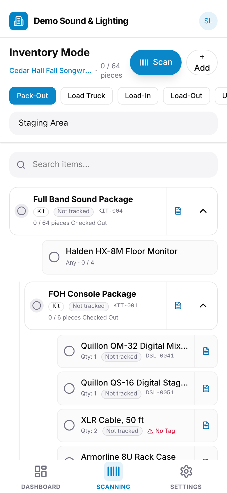

On a phone, the **Scanning** screen tracks a gig's equipment from the warehouse to
the venue and back. Scan each tag, or tap a line to count it, and everyone can see
what's packed, what's on the truck and what hasn't come back.

To open it, go to the gig and select **Packing List**, or tap **Scanning** in the
bottom bar. The screen lists the gig's kits with everything in them. Its header
shows how many pieces are done, such as "12 / 89 pieces".

On a computer, open **Equipment → Out on gigs** and select **Track a gig**: the same
screen opens in a window. Without a camera, type the tag under **Scan** and press Enter
or select **Submit**. Esc closes the scanner and leaves the window open.

## Choosing the step

Tap the step you're doing. Each step records a status and a location:

| Step | Status | Location |
|---|---|---|
| **Pack-Out** | Checked Out | Staging Area |
| **Load Truck** | In Transit | Truck |
| **Load-In** | On Site | Venue Area |
| **Load-Out** | In Transit | Truck |
| **Unload** | In Warehouse | Warehouse |

To record a different place, such as `Truck 2`, type it in the location field before
you scan.

## Scanning tags

Tap **Scan** and point the camera at a tag. If there's no camera, enter the tag under
"Enter a tag number manually" and tap **Submit**.

- **A unit's tag** checks off that unit.
- **A kit's tag** checks off everything in the kit at once.
- **A container's tag**, such as the "Mic Case", checks off the case. What's inside
  travels with it, so you don't scan the contents.

A tag that isn't on the gig shows "… isn't on this gig." In **Pack-Out** and
**Load Truck** you can add it instead; see
[Adding equipment at pack-out](/mobile/adding-at-pack-out/).

You can also tap a unit's circle to check it off by hand, and tap it again to undo.

## Counting pieces

Gear without tags, such as cables and stands, is counted. Tap the line's circle, and a
counter opens. It starts at what the kit already holds from an earlier step (in
**Unload**, what went out), or at the number the kit calls for if nothing's been
counted yet. Use **−** and **+**, or type the number, and tap **Confirm**. Scanning a
lot's tag opens the same counter.

If you pack fewer than the line calls for, the line shows how many, such as
"6 / 8", and stays unchecked until the rest are packed.

## "Any" lines

An "any" line asks for a number of any units of an item, such as
"Halden HX-12P Powered Speaker, Any · 0 / 4".

- **Tagged units:** scan any of your units. Each one fills the line by one.
- **Items with no tags:** tap the line. GigWrangler takes the pieces from what's at
  home and fills the line, skipping lots that are in maintenance or inactive. If there
  aren't enough, a message says how many are short.

## Before you pack

In **Pack-Out**, GigWrangler asks before you pack something that's in Maintenance,
Inactive, or still out at another gig. That includes a case, such as the "Mic Case",
that never came back: "Mic Case is still out at Cedar Hall Fall Songwriter Showcase
(Checked Out, Oct 10)." Tap **Pack anyway** to pack it, or **Cancel**.

## Bringing equipment back

In **Unload**, scan or count everything that came back.

When you count fewer than went out, GigWrangler asks about the rest:

- **Leave at the gig:** they're shown as **Not Returned** until they come back.
- **Mark missing:** they're written off. Only Admins and Managers see this, and it
  needs a connection.

When you're done, tap **Finish unload**. It lists what's still out. Admins and
Managers can tick **Missing** for anything that isn't coming back. Tap **Done**:
everything else stays at the gig as **Not Returned**. You'll find it on the gig's
**Not returned** list; see [Assigning equipment to a gig](/equipment/assigning-to-a-gig/#the-not-returned-list).

## Notes and Maintenance

Tap the note button on a kit or a line to record its condition, such as "Cracked
grille" or "Channel 3 crackles".

The note shows the last record for that item: when, who scanned it, its **Status /
Location**, the gig, and that record's notes if it has any. Enter your note and tap
**Save**.

A note is a record of its own: it never checks anything off or changes a count. A
note on a kit is about the kit as a whole and doesn't touch what's inside it.

### Sending to maintenance

Admins, Managers and Staff can take a unit or lot out of service from its note. Turn
on **Send to Maintenance**, then fill in what you know:

- **Maintenance location**, such as "Repair Bench";
- **Expected back**, the date it should be fixed;
- **How many**, for a lot: 1 to start with, for the one bad cable. With some of the lot
  out at this gig you can flag up to the whole lot; otherwise, up to what's at home.

Your note becomes its condition notes. Tap **Save**. The note ends with "Sent to
Maintenance."

What happens next depends on where it is:

- **Still out**, like a wedge that cracked at the venue: the line is marked **To
  maintenance** (**To maintenance · 2** for part of a lot). It stays on the gig and
  goes into maintenance when you **Unload** it.
- **Home:** it goes into maintenance now, and the line is marked **Maintenance**. Part
  of a lot splits off into its own entry.

Either way it's on the [Maintenance](/equipment/inventory-reports/#maintenance) list.

**A lot that's already flagged** shows "Flagged: 2 of 10". Enter **Add more** to flag
more of it. To change the location or date, edit them and tap **Save**. If it was
flagged at another gig, the note names that gig, and more can only be added there. If
none of a lot is home and none is out at this gig, the note says to flag it from the
gig it's out at.

**To undo it,** turn **Send to Maintenance** off and tap **Save**. A flag is cancelled;
something already in maintenance goes back into service with the status it had
before. Pieces split off a lot go back into their lot from the
[Maintenance](/equipment/inventory-reports/#maintenance) list.

This works offline too, and syncs when you're back online.

**Clear note** empties the box; tap **Save** to keep it empty. **Cancel** closes without
saving.

## Related

- [Adding equipment at pack-out](/mobile/adding-at-pack-out/)
- [Assigning equipment to a gig](/equipment/assigning-to-a-gig/)
- [Inventory reports](/equipment/inventory-reports/)
